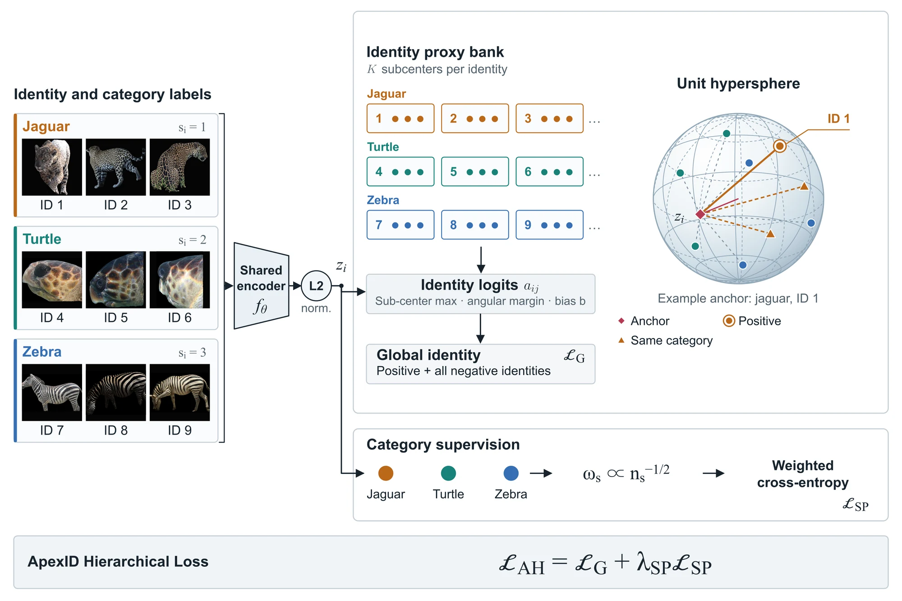

<div align="center">

# ApexID: Hierarchical Learning for Multi-Species Animal Re-Identification

Seifeldin Elkerdany<sup>1,6</sup>, Mohamed ElBassat<sup>2,6</sup>, Gamal Abouelhamd<sup>1,6</sup>, Assem Elkady<sup>2,6</sup>, Jana Ghoneim<sup>2,6</sup>,<br>
Matin Mahmood<sup>3</sup>, Abigail Allen Martin<sup>4</sup>, Gerard de Melo<sup>5</sup>, Antonio Rueda-Toicen<sup>5</sup>

<sup>1</sup>[Alamein International University](https://aiu.edu.eg) &nbsp;
<sup>2</sup>[Alexandria University](https://alexu.edu.eg) &nbsp;
<sup>3</sup>[hyper³labs](https://hyper3labs.com) &nbsp;
<sup>4</sup>[Universidade Federal de Mato Grosso](https://ufmt.br) &nbsp;
<sup>5</sup>[Hasso Plattner Institute](https://hpi.de)<br>
<sup>6</sup>[Made In Alexandria AI Team (M.I.A Robotics)](https://huggingface.co/Made-In-Alexandria-AI)

[](https://mia-ai-team.github.io/ApexID-Hierarchical-Learning-for-Multi-Species-Animal-Re-Identification-Official-Repo/)
[](#citation)
[](https://huggingface.co/Made-In-Alexandria-AI)
[](https://huggingface.co/datasets/Made-In-Alexandria-AI/ApexID-Dataset)
[](LICENSE)

</div>

ApexID is a hierarchical SphereFace2-based loss for animal re-identification. It learns one embedding space shared by every species. A global identity term separates individuals, and a balanced category term keeps broad animal categories organized. We curate 132,533 images from 19 public datasets and evaluate three backbones and four objectives on four external datasets with observation-aware retrieval protocols.

- **Closed-set retrieval:** ApexID is best on all five macro metrics within every backbone family. ConvNeXt-Small with ApexID reaches 64.89% Rank-1, and MIEW-ID v3 with ApexID reaches 32.54% mAP.
- **Unseen species:** on ELPephants, a category absent from all animal Re-ID training, ConvNeXt-Small with ApexID scores 17.69% Rank-1 and 6.63% mAP, the best of the fourteen configurations.
- **Open set:** gains vary by backbone and dataset. A high closed-set score does not imply a high open-set score.

<p align="center">
  
</p>

## Released encoders

All three encoders are trained with the ApexID Hierarchical Loss and return L2-normalized embeddings.

| Encoder | Initialization | Params | Dim. | Input | Weights | Config |
| --- | --- | ---: | ---: | ---: | --- | --- |
| ConvNeXt-Small | ImageNet-1k (TorchVision) | 49.45M | 2048 | 440² | [ApexID_ConvNext_Backbone](https://huggingface.co/Made-In-Alexandria-AI/ApexID_ConvNext_Backbone) | [`configs/default.yaml`](configs/default.yaml) |
| MIEW-ID v3 | [conservationxlabs/miewid-msv3](https://huggingface.co/conservationxlabs/miewid-msv3) | 51.08M | 2152 | 440² | [ApexID_MiewID_Backbone](https://huggingface.co/Made-In-Alexandria-AI/ApexID_MiewID_Backbone) | [`configs/miewid_v3/apexid_hierarchical.yaml`](configs/miewid_v3/apexid_hierarchical.yaml) |
| MegaDescriptor-L | [BVRA/MegaDescriptor-L-384](https://huggingface.co/BVRA/MegaDescriptor-L-384) | 195.20M | 1536 | 384² | [ApexID_MegaDescriptor_Backbone](https://huggingface.co/Made-In-Alexandria-AI/ApexID_MegaDescriptor_Backbone) | [`configs/megadescriptor_l/apexid_hierarchical.yaml`](configs/megadescriptor_l/apexid_hierarchical.yaml) |

## Setup

Use Python 3.12 in an isolated environment. Install PyTorch for your device first, then the pinned requirements.

```bash
git clone https://github.com/MIA-AI-Team/ApexID-Hierarchical-Learning-for-Multi-Species-Animal-Re-Identification-Official-Repo.git ApexID
cd ApexID
python -m venv .venv
source .venv/bin/activate            # PowerShell: .\.venv\Scripts\Activate.ps1
python -m pip install --index-url https://download.pytorch.org/whl/cpu torch==2.10.0 torchvision==0.25.0
python -m pip install -r requirements.txt -c requirements-lock.txt
python -m pip check
```

For GPU use, install a CUDA build of the same PyTorch and TorchVision versions instead of the CPU wheels.

## Quick start: embed an image

Run from the repository root. Swap the config and the Hugging Face repository to use another encoder from the table above.

```python
import numpy as np
import torch
from PIL import Image
from huggingface_hub import hf_hub_download

from apexid.data import build_eval_transforms
from apexid.evaluation.embeddings import ApexIDModelAdapter
from apexid.utils.config import load_config

config = load_config(config_path="configs/default.yaml")
weights = hf_hub_download("Made-In-Alexandria-AI/ApexID_ConvNext_Backbone", "best_backbone.pt")

device = torch.device("cuda" if torch.cuda.is_available() else "cpu")
model = ApexIDModelAdapter.from_checkpoint(config, weights, device).model
transform = build_eval_transforms(config=config)

rgb = np.asarray(Image.open("animal.png").convert("RGB"))  # a segmented foreground works best
with torch.inference_mode():
    x = transform(image=rgb)["image"][None].to(device)
    embedding = model(x)  # shape (1, 2048), L2-normalized
```

Compare embeddings with cosine similarity (a dot product, since they are normalized) to rank a gallery against a query.

## Results

Dataset-macro closed-set retrieval over four external datasets (ELPephants, GCN-ID, Bristol Gorillas and private jaguar data) and five observation-disjoint split seeds, in percent. **Bold** marks the best value within each backbone family. *Pretrained* rows use the original animal Re-ID checkpoints.

| Backbone | Loss | Rank-1 | mAP | mINP | ID-bal. mAP | ID-bal. Rank-1 |
| --- | --- | ---: | ---: | ---: | ---: | ---: |
| ConvNeXt-Small | ArcFace | 62.24 | 29.54 | 14.57 | 30.08 | 59.36 |
| | Dynamic ArcFace | 61.75 | 29.23 | 14.51 | 29.62 | 58.72 |
| | SphereFace2 | 63.60 | 30.24 | 15.31 | 30.83 | 60.78 |
| | **ApexID Hierarchical** | **64.89** | **30.84** | **15.71** | **31.72** | **62.13** |
| MIEW-ID v3 | Pretrained | 58.14 | 27.40 | 13.74 | 27.74 | 55.54 |
| | ArcFace | 63.65 | 32.09 | 17.71 | 32.60 | 60.82 |
| | Dynamic ArcFace | 62.72 | 31.51 | 17.31 | 32.06 | 60.07 |
| | SphereFace2 | 63.40 | 31.89 | 17.78 | 32.44 | 60.64 |
| | **ApexID Hierarchical** | **63.88** | **32.54** | **18.28** | **33.23** | **61.62** |
| MegaDescriptor-L | Pretrained | 54.01 | 23.62 | 10.66 | 24.11 | 50.82 |
| | ArcFace | 58.20 | 27.13 | 13.05 | 27.53 | 55.52 |
| | Dynamic ArcFace | 55.44 | 25.51 | 11.75 | 25.49 | 52.34 |
| | SphereFace2 | 57.13 | 26.61 | 12.47 | 26.79 | 54.43 |
| | **ApexID Hierarchical** | **61.18** | **29.07** | **14.69** | **29.85** | **58.52** |

The [project page](https://mia-ai-team.github.io/ApexID-Hierarchical-Learning-for-Multi-Species-Animal-Re-Identification-Official-Repo/) has interactive versions of these tables, the ELPephants transfer results, the open-set evaluation, the category-weight ablation and ScoreCAM maps.

## Data

The [ApexID Dataset](https://huggingface.co/datasets/Made-In-Alexandria-AI/ApexID-Dataset) card lists all 19 sources with their licenses and links. It hosts the split manifests, and segmented images for the sources whose licenses allow redistribution. For the other sources, download the originals from their authors.

| Partition | Images | Identities |
| --- | ---: | ---: |
| Training | 90,921 | 11,677 |
| Known-identity validation | 28,070 | 10,768 |
| Held-out-identity validation | 13,542 | 1,671 |

The frozen splits are checked in under [`open_set_splits_v2/`](open_set_splits_v2). The [data guide](data/README.md) documents the foreground corpus, the split files and the observation-aware partitioner. Set `APEXID_DATA_ROOT` to the folder that holds the manifest-relative image paths (default `ApexID_Dataset/`).

## Training and evaluation

```bash
python scripts/debug_data_pipeline.py --config configs/default.yaml --skip-batch
python scripts/train.py --config configs/default.yaml
```

The default preset trains ConvNeXt-Small with the ApexID Hierarchical Loss. Presets for every cell of the paper's backbone-by-loss matrix, the category-weight sweep and the pretrained baselines are listed in [`configs/`](configs/README.md).

The [evaluation guide](docs/evaluation.md) covers preparing external manifests, extracting embeddings, the five-seed observation-disjoint retrieval protocol and the open-set protocol. The open-set pipeline follows [AnimalCLEF26](https://github.com/MIA-AI-Team/AnimalCLEF26) ([arXiv:2608.02469](https://arxiv.org/abs/2608.02469)). The private jaguar evaluation images and labels are not distributed.

```bash
python -m pytest -q
```

## Citation

```bibtex
@article{elkerdany2026apexid,
  title   = {ApexID: Hierarchical Learning for Multi-Species Animal Re-Identification},
  author  = {Elkerdany, Seifeldin and ElBassat, Mohamed and Abouelhamd, Gamal and
             Elkady, Assem and Ghoneim, Jana and Mahmood, Matin and
             Martin, Abigail Allen and de Melo, Gerard and Rueda-Toicen, Antonio},
  journal = {arXiv preprint},
  year    = {2026}
}
```

## License

The code and the ConvNeXt-Small ApexID weights are under the [MIT License](LICENSE). The fine-tuned MegaDescriptor-L weights derive from [BVRA/MegaDescriptor-L-384](https://huggingface.co/BVRA/MegaDescriptor-L-384) and keep its CC BY-NC 4.0 terms. The fine-tuned MIEW-ID v3 weights derive from [conservationxlabs/miewid-msv3](https://huggingface.co/conservationxlabs/miewid-msv3), which declares no license, so check its terms before commercial use. Datasets keep their own licenses; see [third-party provenance](THIRD_PARTY_PROVENANCE.md).
